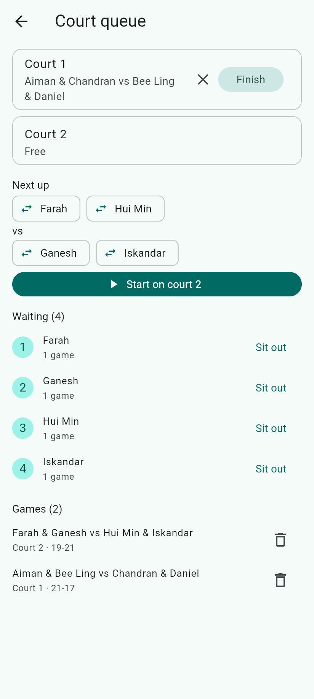

# gelanggang

**Badminton session organiser: share court and shuttle costs fairly, to the sen.**

*Gelanggang* is Malay for "court". Many social badminton groups have one person who books the courts, buys the
shuttles and then works out who owes what in the group chat. gelanggang is a small Flutter app for that person.
It runs on Android, iOS and the web, keeps everything on the device (no account, no server), and never touches
money. It only works out the amounts and writes a message you can paste into WhatsApp.

<p>
  
  
  
</p>

## What it does

- **Players**: keep your group's roster (names are trimmed, duplicates refused).
- **Sessions**: date, venue, start/end time, number of courts and hourly court rate, shuttles used and price
  per shuttle. Court hire = courts × rate × hours, rounded half up to the sen.
- **Who came**: tick the players who came; change arrival/leaving times for late arrivals or early leavers.
- **Fair split**, in integer sen with the largest remainder method, so the shares always add up exactly to
  the total:
  - *Split equally* among everyone who came, or
  - *By time played*, in proportion to the minutes each player was at the court.
- **Settle up**: mark who has paid, see what is left to collect, and copy a ready-made message for the group.
  There are no payment links and no wallet; pay each other however you like.
- **Court queue**: a "who plays next" board for doubles. It shows each court (free, or who is on it), suggests
  the next four and pairs them up, keeps a waiting list and logs finished games with an optional score.
  - Whoever came off court longest ago goes first (someone who has not played yet has waited since the
    start); ties go to whoever has played fewer games, then to whoever was ticked in first.
  - The four are paired to avoid repeat partners first and repeat opponents second.
  - The suggestion is deterministic. Tap a name to swap in someone else, mark a player as sitting out (they
    still share the cost), take a game off court, or remove a wrong log entry.
  - The queue does not watch the clock: when someone leaves early, mark them as sitting out.
- Data is saved on the device (`shared_preferences`, which is local storage on the web). The first launch adds a
  synthetic demo group so you can try it straight away.

Planned next: split by games played, guest fees, balances carried across sessions, BM/中文 translations, and
JSON backup/restore. See the roadmap below.

## Run it

```bash
flutter pub get
flutter run -d chrome        # or an Android/iOS device or emulator
flutter test                 # unit + widget tests
flutter build web --release  # static site in build/web
```

Built and tested with Flutter 3.50 (Dart 3.14).

## How it is built

- Flutter with Material widgets (`material_ui`), and state in a single `ChangeNotifier` store
  (`lib/src/data/store.dart`). Every change is saved as one versioned JSON document. Unreadable or
  newer-version data is ignored instead of crashing the app.
- Pure Dart domain code in `lib/src/domain`: money parsing and formatting in sen, the largest-remainder split,
  costs, the settle-up message and the court queue. It is tested on its own, including a randomised test (2,000
  runs) checking that shares always add up and never differ from the exact share by a sen or more.
- The queue has property tests over 3,000 random groups (4-16 players, 1-4 courts, 40 rounds each). When games
  last about the same time, games played never differ by more than one and nobody plays twice while someone
  else waits. In any finishing order, nobody jumps the queue, the suggestion is the same after a save and
  reload, and the pairing never repeats a partnership that could have been avoided.
- Widget tests drive the real screens: add players, create a session (with form validation), tick
  attendance, mark paid, switch to split by time, edit arrival times, check the message text, and run the
  court queue (swap a player, start a game, refuse a drawn score, log a result, sit someone out).
- GitHub Actions runs `dart format`, `flutter analyze`, `flutter test --coverage` and `flutter build web` on
  every push and pull request.

## Roadmap

1. ✅ Roster, sessions, attendance, equal / by-time split, settle-up message, local storage, CI.
2. ✅ Court queue and game log with a fair "next four" suggestion (deterministic, with property tests).
3. More split modes (by games played, guest fee), balances carried over, history.
4. Bahasa Melayu and 简体中文, accessibility pass, JSON backup/restore, integration tests.

## Privacy

Everything stays on your device. The demo data and screenshots use made-up names.

## License

MIT
