# gelanggang

**Badminton session organiser: share court and shuttle costs fairly, to the sen.**

*Gelanggang* is Malay for "court". Many social badminton groups have one person who books the courts, buys the
shuttles and then works out who owes what in the group chat. gelanggang is a small Flutter app for that person.
It runs on Android, iOS and the web, keeps everything on the device (no account, no server), and never touches
money. It only works out the amounts and writes a message you can paste into WhatsApp.

<p>
  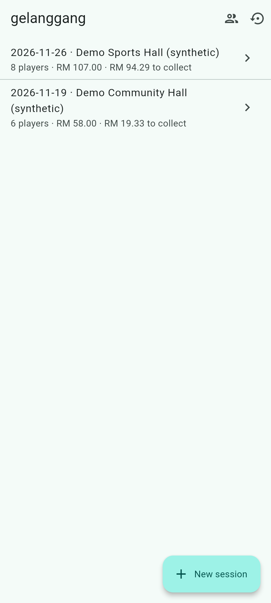
  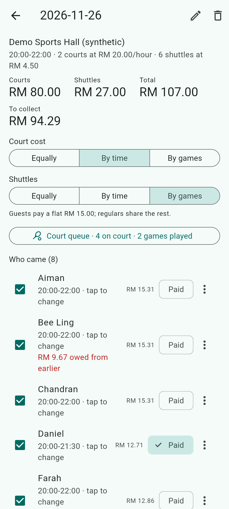
  
</p>
<p>
  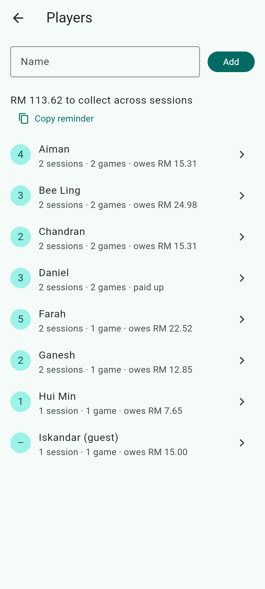
  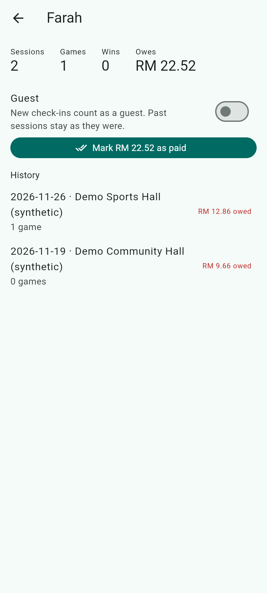
  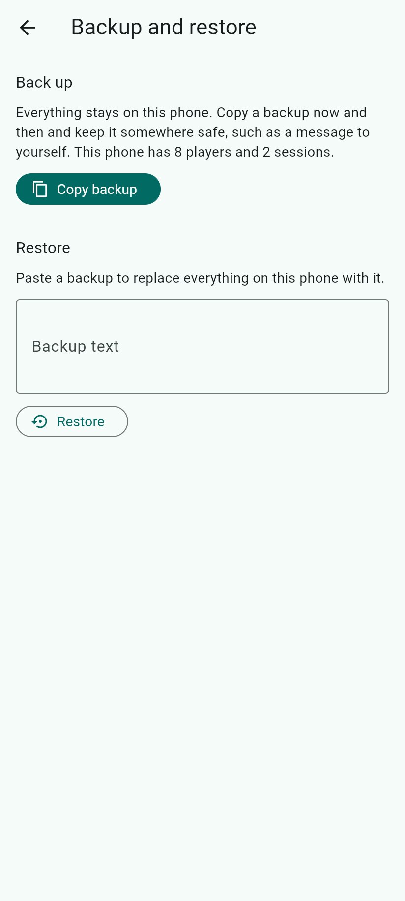
</p>
<p>
  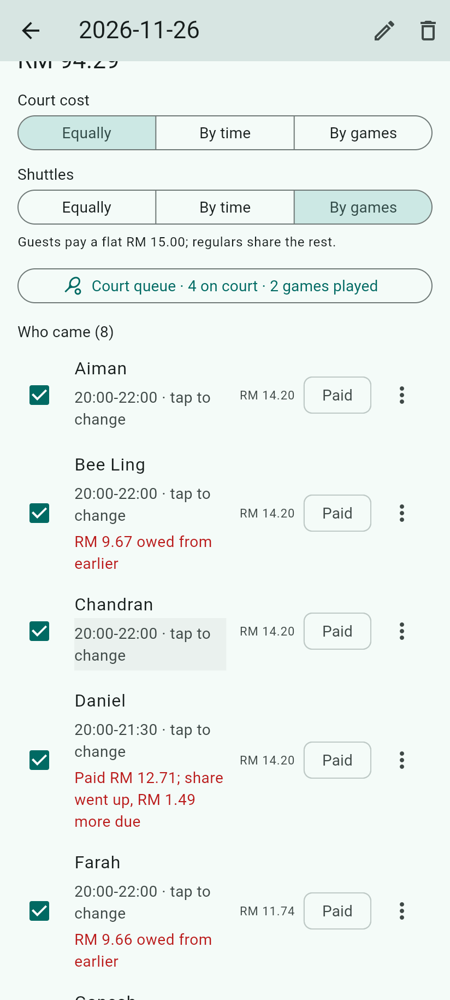
  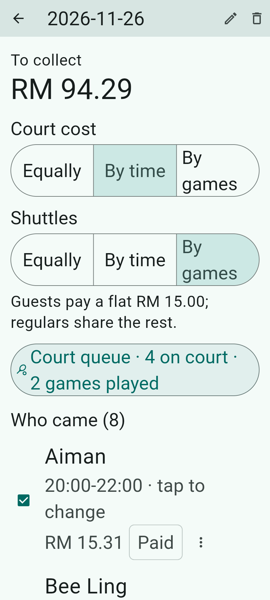
</p>
<p>
  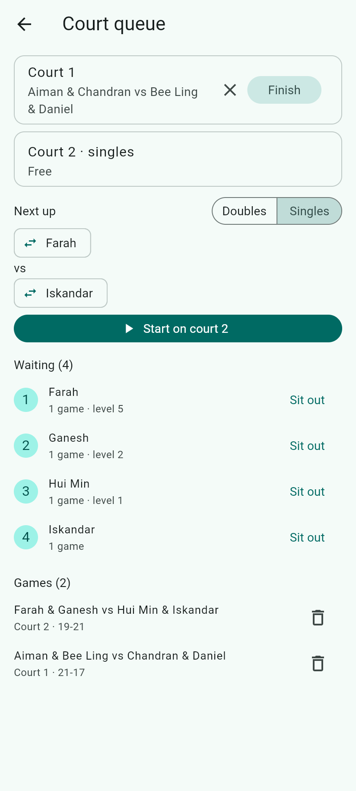
  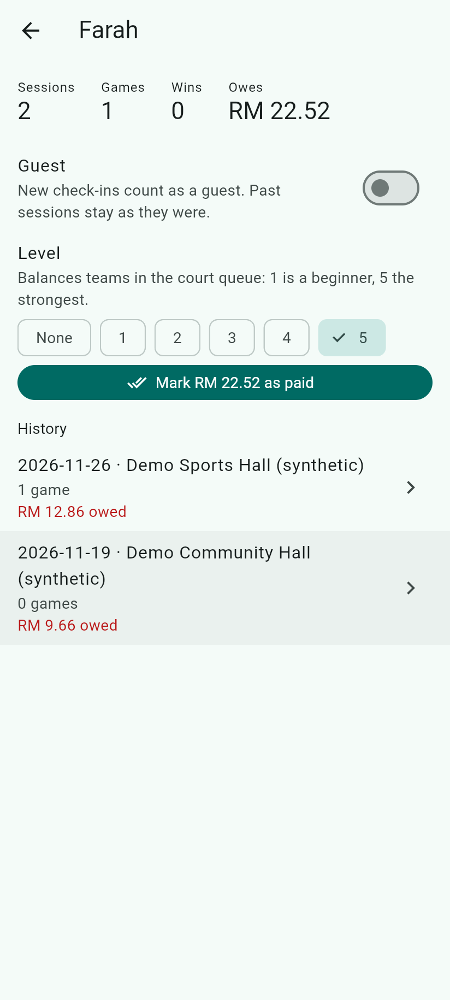
</p>
<p>
  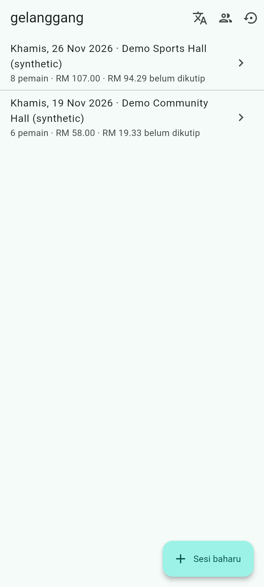
  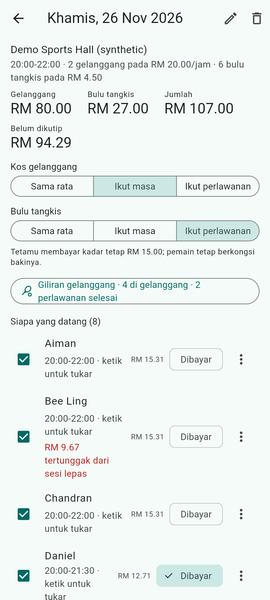
  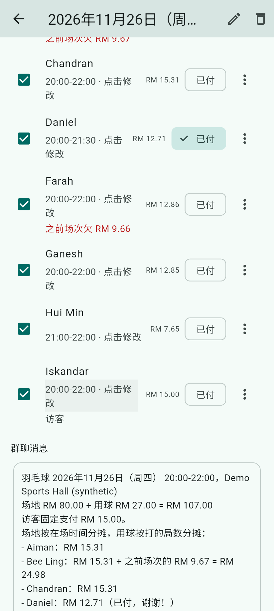
</p>

## What it does

- **Players**: keep your group's roster (names are trimmed, duplicates refused). Mark someone as a guest and
  they check in as a guest from then on (sessions already recorded keep what they were). Give a player an
  optional **level** from 1 (beginner) to 5 (strongest) on their screen; it shows as a badge on the roster
  and helps the court queue balance teams.
- **Sessions**: date, venue, start/end time, number of courts and hourly court rate, shuttles used and price
  per shuttle. Court hire = courts × rate × hours, rounded half up to the sen.
- **Who came**: tick the players who came; change arrival/leaving times for late arrivals or early leavers.
- **Fair split**, in integer sen with the largest remainder method, so the shares always add up exactly to
  the total:
  - *Equally* among everyone who came,
  - *By time*, in proportion to the minutes each player was at the court, or
  - *By games*, in proportion to the games each player started (handy for shuttles). With no games logged
    yet it falls back to equal.
  - The court hire and the shuttles each have their own mode, e.g. courts by time and shuttles by games.
  - **Guest fee**: give a session a flat guest fee and each guest pays exactly that; the regulars share the
    rest (the fees go towards the court hire first, then the shuttles). With no guests, no regulars or no fee,
    everyone shares alike. If the fees would come to more than the whole session, the guests split the total
    and the regulars pay nothing. A player can be switched between guest and regular for one session.
- **Settle up**: mark who has paid, see what is left to collect, and copy a ready-made message for the group.
  There are no payment links and no wallet; pay each other however you like.
- **Paid amounts**: ticking *Paid* records the share at that moment. If the share goes up later (a late
  arrival changes the split, more shuttles), the row says "Paid RM 12.71; share went up, RM 1.49 more due" and
  the difference is still owed everywhere (to collect, balances, reminders). If it goes down, the row shows how
  much to give back. Tick *Paid* again to record the new amount in full, or choose *Mark as not paid* in the
  row's ⋮ menu to set any paid share (part-paid included) straight back to unpaid. Payments recorded by older
  versions count as paid in full.
- **Balances carried over**: unpaid shares from earlier sessions are shown on each player's row and added to
  their line in the message ("RM 12.86 + RM 9.66 from earlier sessions = RM 22.52").
- **History**: the Players screen shows each player's sessions, games and what they owe across all sessions,
  with a "Copy reminder" message listing everyone who still owes. Open a player for their session history,
  wins, and a button to mark everything they owe as paid.
- **Court queue**: a "who plays next" board for doubles and singles. It shows each court (free, or who is on
  it), suggests the next game and pairs it up, keeps a waiting list and logs finished games with an optional
  score.
  - **Doubles or singles per court**: the Doubles / Singles switch next to "Next up" sets the court the
    suggestion is for (the lowest free court, or when all are busy the one in play longest). A singles court
    suggests two players; the setting is kept with the session and a game already on court carries on.
  - Whoever came off court longest ago goes first (someone who has not played yet has waited since the
    start); ties go to whoever has played fewer games, then to whoever was ticked in first.
  - **Levels never break that order.** Only among players who have waited exactly as long as the last one who
    fits can levels change who plays, and only to avoid a big level gap (3 or more, e.g. a level 1 with a
    level 4): the earliest ticked-in group without one is picked, or the group with the smallest gap if every
    group has one. A player passed over this way has waited longer than everyone else next time, so they go
    first. Players without a level do not count towards a gap.
  - The four are paired to avoid repeat partners first, then to make the two teams' level sums as close as
    possible (a player without a level counts as the average of the others), then to avoid repeat opponents.
    When all four have levels the board shows the totals ("Levels 7 v 7").
  - The suggestion is deterministic. Tap a name to swap in someone else, mark a player as sitting out (they
    still share the cost), take a game off court, or remove a wrong log entry.
  - The queue does not watch the clock: when someone leaves early, mark them as sitting out.
- **Backup and restore**: copy everything as readable JSON text (keep it in a message to yourself or a notes
  app) and paste it on another phone to restore. A backup is checked as a whole before anything is replaced:
  it must be complete, from this or an older version, with no repeated ids or names, every player in a session
  on the roster, and every session passing the same rules as the app's own forms. You see what it holds and
  what it replaces before you confirm. No files, cloud or extra permissions are needed.
- **Unreadable data is kept, not lost**: if the saved data cannot be read (damaged, or from a newer version
  of the app), it is set aside untouched before anything new is saved. A badge on the backup button leads to
  a card where you can copy it out, or throw it away.
- **Accessibility**: icon buttons have labels, per-row controls name the player ("Aiman paid", "Change times
  for Aiman, 20:00 to 22:00"), figures read as one item ("Total RM 107.00"), tap targets are at least 48 px,
  and with large text each player's share and buttons move onto their own line instead of squeezing the name.
- Data is saved on the device (`shared_preferences`, which is local storage on the web). The first launch adds a
  synthetic demo group so you can try it straight away (only on a real first launch, never over saved data).

- **Languages**: English, Bahasa Melayu and 简体中文 (see below).

## Languages

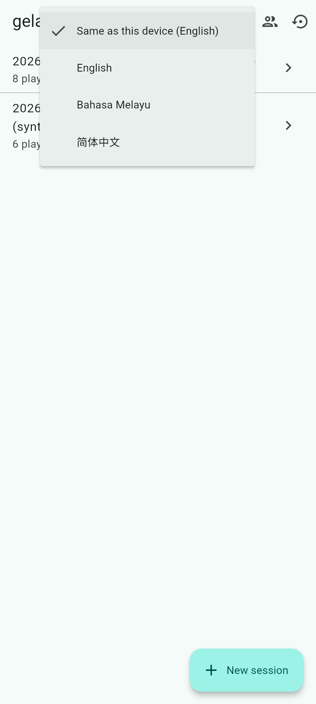

- The whole app is translated: every screen, dialog, button, screen-reader label and error message, and the
  two messages you paste into the group chat (the settle-up message and the balances reminder). Material's
  own texts (back button, menus, text editing) follow too.
- By default the app follows the device language: Malay (`ms`) and Chinese (`zh`) devices get Bahasa Melayu
  and 简体中文, anything else gets English. Pick a language with the 文A button on the home screen to override
  it; the choice is kept on the device (apart from your data, so a backup or restore never changes it), and
  *Same as this device* goes back to following the device.
- Money is shown as `RM 1,234.50` in every language, as it is written in Malaysia. Dates: English keeps the
  ISO date (`2026-11-26`); Bahasa Melayu shows `Khamis, 26 Nov 2026` and Chinese `2026年11月26日（周四）`.
  Times are 24-hour (`20:00`) everywhere. Names and venues you type are never translated.
- Texts live in `lib/src/l10n/`: each key carries its English text in `strings.dart`, with the translations in
  `ms.dart` and `zh.dart`. Tests check that every key is translated in every language with exactly the same
  `{placeholders}`, that every key is used and every key used exists, and they render every screen in Malay
  and Chinese (no English left, accessibility guidelines, twice the text size).
- The translations were written for this project and have not yet been reviewed by native speakers;
  corrections are welcome.

<br clear="right">

## Run it

```bash
flutter pub get
flutter run -d chrome        # or an Android/iOS device or emulator
flutter test                 # unit + widget tests
flutter build web --release  # static site in build/web
```

### End-to-end tests on a real app

`integration_test/app_flows_test.dart` starts the real app (the same `loadApp()` as `main()`, with the real
`shared_preferences` plugin and clipboard) and drives it like an organiser:

1. **A club night**: first launch shows the demo group; add a player (a duplicate is refused); create a session;
   check in five players; run a court-queue game and log 21-15; split courts and shuttles by games (the player
   who only waited pays RM 0.00); mark a share paid; then close and reopen the app and find everything,
   including the game and the payment, read back from the device. Then switch court 1 to singles, play a
   one-on-one game (the player who waited plays the first of the others), log 21-10, reopen again and find
   the singles court, the game and the new split by games.
2. **Backup round-trip**: copy a backup through the system clipboard, start a "new phone" with nothing saved,
   refuse a cut-off paste, restore the whole backup after the confirmation, restart, and check it stayed.
3. **Language switch**: switch to 简体中文 (dates and the settle-up message follow), restart and stay in Chinese,
   switch to Bahasa Melayu, then back to following the device.

Each flow starts with nothing saved (so running them clears the app's saved data on that device), checks what the plugin wrote to disk (not just its in-memory copy), and
runs on a phone-shaped 432 x 960 screen. On Linux (as in CI):

```bash
sudo apt-get install clang cmake ninja-build pkg-config libgtk-3-dev xvfb   # Linux desktop toolchain
xvfb-run -a flutter test integration_test -d linux                          # or -d <android device>
```

Breaking the data save, the language save or the restore made these tests fail (checked on purpose).

Built and tested with Flutter 3.50 (Dart 3.14).

## How it is built

- Flutter with Material widgets (`material_ui`), and state in a single `ChangeNotifier` store
  (`lib/src/data/store.dart`). Every change is saved as one versioned JSON document. Unreadable or
  newer-version data is set aside instead of crashing the app or being overwritten.
- Pure Dart domain code in `lib/src/domain`: money parsing and formatting in sen, the largest-remainder split,
  costs, the settle-up message and the court queue. It is tested on its own, including a randomised test (2,000
  runs) checking that shares always add up and never differ from the exact share by a sen or more.
- The queue has property tests over 3,000 random groups (4-16 players, 1-4 courts, 40 rounds each). When games
  last about the same time, games played never differ by more than one and nobody plays twice while someone
  else waits. In any finishing order, nobody jumps the queue, the suggestion is the same after a save and
  reload, and the pairing never repeats a partnership that could have been avoided.
- Levels and singles have their own property test (150 random groups of 2-14 players with random levels,
  some missing, and random singles courts, 40 rounds each, in any finishing order), checked against brute
  force: nobody who waited longer is passed over, the group picked is the first without a big level gap (or
  the smallest gap), the team split is the cheapest of the three (repeat partners, then level gap, then
  repeat opponents), without levels the queue is exactly as before, and splits by games still add up with
  singles games mixed in. Nine deliberate bugs (ignoring levels, reordering the pairing rules, an off-by-one
  gap limit, counting a missing level as 0, widening the fairness tie group, and others) each made a test
  fail.
- Widget tests drive the real screens: add players, create a session (with form validation), tick
  attendance, mark paid, switch to split by time, edit arrival times, check the message text, and run the
  court queue (swap a player, start a game, refuse a drawn score, log a result, sit someone out), switch a
  guest to a regular, change the split modes, edit the guest fee, copy the balances reminder and mark a
  player's sessions paid.
- The split modes and guest fee have a randomised test (2,000 sessions with random guests, times, games, modes
  and fees): shares always add up to the total, nobody goes below zero and a guest never pays more than the
  fee. Saved data from before this version (one split mode, no guests) still loads, and damaged fees or guest
  flags are ignored without overwriting what is saved.
- Backup tests restore the demo group on a fresh store and compare it byte for byte, survive a restart, and
  refuse 33 kinds of bad backup (cut off, wrong types, newer version, unknown players, repeated ids, invalid
  sessions, games and scores, levels outside 1-5, singles on a court the session does not have) each with its own message and without changing anything. Paid-amount tests cover
  shares going up and down after paying, settle all, carried-over balances and damaged amounts. Accessibility
  tests run Material's tap target, label and contrast guidelines on every screen, activate a control through
  the semantics tree, and check every screen at twice the text size for overflow and squeezed text. Key
  checks are mutation-tested (each was broken on purpose and a test failed). Language tests are described
  under [Languages](#languages).
- GitHub Actions runs `dart format`, `flutter analyze`, `flutter test --coverage` and `flutter build web` on
  every push and pull request, and a second job runs the [end-to-end tests](#end-to-end-tests-on-a-real-app)
  on the Linux desktop app under `xvfb`.
- Long dates in the session title (Chinese and Malay, with the weekday) shrink to fit a narrow phone instead of
  losing the weekday to an ellipsis (tested at 360 dp, normal and 1.3x text).

## Roadmap

1. ✅ Roster, sessions, attendance, equal / by-time split, settle-up message, local storage, CI.
2. ✅ Court queue and game log with a fair "next four" suggestion (deterministic, with property tests).
3. ✅ Split by games, separate court/shuttle modes, guest fee, balances carried over, player history.
4. ✅ Backup/restore, unreadable data set aside, paid amounts, accessibility pass.
5. ✅ Bahasa Melayu and 简体中文 (whole UI and the group messages), language picker, one-step "not paid".
6. ✅ End-to-end tests on the real app (`integration_test`, Linux desktop in CI), session title fits narrow phones.
7. ✅ Player levels (1-5) and singles courts in the queue: no big level gaps among equally-waiting players,
   balanced team level sums, fairness order unchanged.

## Privacy

Everything stays on your device. The demo data and screenshots use made-up names.

## License

MIT
